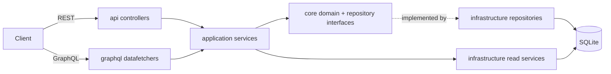

# 

> A Spring Boot + MyBatis implementation of the [RealWorld](https://github.com/gothinkster/realworld) "Conduit" API — a Medium.com-style social blogging backend — exposing both a **REST** API and a **GraphQL** API over the same domain model.

This service is the backend for the Angular frontend in
[`Samir-Chaudhry-Enterprise/angular-realworld-example-app`](https://github.com/Samir-Chaudhry-Enterprise/angular-realworld-example-app),
and is compatible with any other frontend that follows the RealWorld API spec.

- [Features](#features)
- [Tech stack](#tech-stack)
- [Prerequisites](#prerequisites)
- [Quick start](#quick-start)
- [Build, run, test, format](#build-run-test-format)
- [Configuration](#configuration)
- [API overview](#api-overview)
- [Authentication](#authentication)
- [Project structure](#project-structure)
- [Architecture](#architecture)
- [Docker](#docker)
- [Running with a frontend](#running-with-a-frontend)
- [Contributing](#contributing)
- [License](#license)

Deeper documentation lives in [`docs/`](docs):

| Document | Contents |
| --- | --- |
| [docs/ARCHITECTURE.md](docs/ARCHITECTURE.md) | Layers and packages, domain model, request flow, security, persistence, diagrams |
| [docs/API.md](docs/API.md) | Full REST endpoint reference with example requests/responses, error formats, GraphQL reference |
| [docs/FULL_STACK.md](docs/FULL_STACK.md) | Running this backend together with the Angular frontend |

## Features

- **Users & auth** — register, log in, fetch/update the current user; stateless JWT authentication.
- **Profiles** — view any user's profile; follow / unfollow users.
- **Articles** — create, read, update, delete; slugs generated from the title; tags per article.
- **Article listing** — global list filterable by `tag`, `author` and `favorited`, with `offset`/`limit` pagination; a personal **feed** of articles from followed authors.
- **Favorites** — favorite / unfavorite articles, with per-article favorite counts.
- **Comments** — add, list and delete comments on articles.
- **Tags** — list all tags in use.
- **GraphQL API** — the same capabilities exposed through a GraphQL schema (Netflix DGS) with Relay-style cursor pagination, plus a GraphiQL IDE.
- **Validation** — Bean Validation on all inputs (including uniqueness checks for email, username and article title) with RealWorld-style `422` error bodies.
- **Database migrations** — schema managed by Flyway; SQLite file database by default.

## Tech stack

Versions below are taken from [`build.gradle`](build.gradle), the Gradle wrapper, and the resolved dependency tree.

| Area | Technology | Version |
| --- | --- | --- |
| Language | Java (source/target compatibility) | 11 |
| Build | Gradle (wrapper) | 7.4 |
| Framework | Spring Boot (Web, Validation, Security, HATEOAS) | 2.6.3 |
| Security | Spring Security | 5.6.1 |
| Persistence | MyBatis (`mybatis-spring-boot-starter` 2.2.2) | 3.5.9 |
| Migrations | Flyway (`flyway-core`, Boot-managed) | 8.0.5 |
| Database | SQLite (`org.xerial:sqlite-jdbc`) | 3.36.0.3 |
| GraphQL | Netflix DGS (`graphql-dgs-spring-boot-starter`) / graphql-java | 4.9.21 / 17.3 |
| GraphQL codegen | `com.netflix.dgs.codegen` Gradle plugin | 5.0.6 |
| JWT | JJWT (`jjwt-api`, `jjwt-impl`, `jjwt-jackson`) | 0.11.2 |
| Dates | Joda-Time | 2.10.13 |
| Boilerplate | Lombok (Boot-managed) | 1.18.22 |
| Formatting | Spotless (`com.diffplug.spotless`) with google-java-format | 6.2.1 / 1.13.0 |
| Testing | JUnit 5 (via `spring-boot-starter-test`), REST Assured `spring-mock-mvc`, `mybatis-spring-boot-starter-test`, `spring-security-test` | REST Assured 4.5.1 |
| Server | Embedded Tomcat | 9.0.56 |

## Prerequisites

- **JDK 11.** CI ([`.github/workflows/gradle.yml`](.github/workflows/gradle.yml)) builds with Zulu JDK 11.
  - JDK 17 can compile, test and run the app (`./gradlew test`, `./gradlew bootRun`), but the Spotless/google-java-format step used by `./gradlew build`, `spotlessCheck` and `spotlessApply` fails on JDK 17 with an `InvocationTargetException`. Use JDK 11 for the full build.
- No separate Gradle install is needed — use the included wrapper (`./gradlew`, or `gradlew.bat` on Windows).
- No database server is needed — SQLite is embedded and the database file is created automatically.
- Optional: Docker, for `bootBuildImage` (see [Docker](#docker)).

## Quick start

```bash
./gradlew bootRun
```

The API is served from the root of `http://localhost:8080` (there is **no** `/api` prefix):

```bash
curl http://localhost:8080/tags
# {"tags":[]}
```

Register a user and use the returned token:

```bash
curl -s -X POST http://localhost:8080/users \
  -H 'Content-Type: application/json' \
  -d '{"user":{"email":"jake@jake.jake","username":"jake","password":"jakejake"}}'

curl http://localhost:8080/user -H "Authorization: Token <token-from-above>"
```

GraphiQL is available at http://localhost:8080/graphiql and the GraphQL endpoint at `POST http://localhost:8080/graphql`.

## Build, run, test, format

All commands use the Gradle wrapper and are run from the repository root.

| Task | Command | Notes |
| --- | --- | --- |
| Full build | `./gradlew build` | Compiles, generates GraphQL types, runs tests and `spotlessCheck`, and produces `build/libs/spring-boot-realworld-example-app-0.0.1-SNAPSHOT.jar`. |
| Run (dev) | `./gradlew bootRun` | Starts on port 8080 using `dev.db` in the working directory. |
| Run (jar) | `java -jar build/libs/spring-boot-realworld-example-app-0.0.1-SNAPSHOT.jar` | After `./gradlew build` (or `./gradlew bootJar`). |
| Test | `./gradlew test` | 68 JUnit 5 tests (web-layer, application-service, repository and JWT tests). CI runs `./gradlew clean test`. |
| Check formatting | `./gradlew spotlessCheck` | google-java-format over all `*.java` files (excluding generated sources). |
| Apply formatting | `./gradlew spotlessApply` (or `./gradlew spotlessJavaApply`) | Rewrites files in place. |
| Generate GraphQL types | `./gradlew generateJava` | Runs automatically before compilation; output goes to `build/generated` in package `io.spring.graphql`. |
| Clean | `./gradlew clean` | Also deletes `./dev.db`. |
| Container image | `./gradlew bootBuildImage --imageName spring-boot-realworld-example-app` | Cloud Native Buildpacks; requires Docker. |

There is no separate linter beyond Spotless, and the repository has no pre-commit hooks.

## Configuration

Configuration lives in [`src/main/resources/application.properties`](src/main/resources/application.properties). The `test` profile ([`application-test.properties`](src/main/resources/application-test.properties)) switches the datasource to an in-memory SQLite database and is used by the repository tests.

| Property | Default | Purpose |
| --- | --- | --- |
| `spring.datasource.url` | `jdbc:sqlite:dev.db` | JDBC URL. The path is relative to the process working directory. |
| `spring.datasource.driver-class-name` | `org.sqlite.JDBC` | JDBC driver. |
| `spring.datasource.username` / `password` | *(empty)* | Datasource credentials. |
| `spring.jackson.deserialization.UNWRAP_ROOT_VALUE` | `true` | Request bodies are wrapped in a root object (e.g. `{"user": {...}}`), matched via `@JsonRootName`. |
| `image.default` | `https://static.productionready.io/images/smiley-cyrus.jpg` | Default avatar assigned to newly registered users. |
| `jwt.secret` | *(a fixed development value)* | HMAC signing key for JWTs. **Override in any non-local environment.** |
| `jwt.sessionTime` | `86400` | Token lifetime in seconds (24 h). |
| `mybatis.mapper-locations` | `mapper/*.xml` | MyBatis XML mappers. |
| `mybatis.type-handlers-package` | `io.spring.infrastructure.mybatis` | Registers the Joda `DateTime` type handler. |
| `mybatis.configuration.*` | cache enabled, 3000 ms statement timeout, underscore→camelCase mapping, generated keys | MyBatis settings. |
| `logging.level.io.spring.infrastructure.mybatis.*` | `DEBUG` | Logs SQL issued by the mappers/read services. |

Any property can be overridden using standard Spring Boot mechanisms, e.g. environment variables or command-line arguments:

```bash
SERVER_PORT=8081 \
JWT_SECRET='<at-least-32-random-bytes; 64+ bytes recommended>' \
JWT_SESSIONTIME=3600 \
java -jar build/libs/spring-boot-realworld-example-app-0.0.1-SNAPSHOT.jar

# or
./gradlew bootRun --args='--server.port=8081'
```

### Database

- SQLite is used by default so data survives restarts; the file (`dev.db`) is created in the working directory on first start and is git-ignored.
- The schema is created by Flyway from [`src/main/resources/db/migration`](src/main/resources/db/migration) (`V1__create_tables.sql`) on startup.
- To use another database, change `spring.datasource.*`, add the JDBC driver dependency, and check the MyBatis XML mappers for SQLite-specific SQL (e.g. `limit #{offset}, #{limit}` syntax).
- Deleting `dev.db` (or running `./gradlew clean`) resets all data.

### JWT secret

`jwt.secret` is used as raw bytes for an HMAC key. JJWT rejects keys shorter than 256 bits (32 bytes) — a shorter secret causes requests that issue tokens (register/login) to fail with HTTP 500 (`WeakKeyException`). With the default 86-byte secret, tokens are signed with **HS512**.

### Port

No `server.port` is set, so Spring Boot's default **8080** applies. Override with `SERVER_PORT` or `--server.port`.

### CORS

CORS is configured in code in [`WebSecurityConfig`](src/main/java/io/spring/api/security/WebSecurityConfig.java), not in properties:

- Allowed origins: `*`
- Allowed methods: `HEAD, GET, POST, PUT, DELETE, PATCH`
- Allowed headers: `Authorization, Cache-Control, Content-Type`
- Credentials: not allowed (`allowCredentials=false`)

Change `corsConfigurationSource()` to restrict origins for production.

## API overview

All REST endpoints are relative to `http://localhost:8080`. Full request/response examples are in [docs/API.md](docs/API.md).

"Auth" column: **Required** — a valid token is needed (otherwise `401`); **Optional** — works anonymously, but a token personalizes `following` / `favorited` fields; **None** — public.

### Users & authentication

| Method | Path | Auth | Description |
| --- | --- | --- | --- |
| `POST` | `/users` | None | Register (`201`) |
| `POST` | `/users/login` | None | Log in |
| `GET` | `/user` | Required | Current user |
| `PUT` | `/user` | Required | Update current user |

### Profiles

| Method | Path | Auth | Description |
| --- | --- | --- | --- |
| `GET` | `/profiles/{username}` | Optional | Get a profile |
| `POST` | `/profiles/{username}/follow` | Required | Follow a user |
| `DELETE` | `/profiles/{username}/follow` | Required | Unfollow a user |

### Articles

| Method | Path | Auth | Description |
| --- | --- | --- | --- |
| `GET` | `/articles` | Optional | List articles (`tag`, `author`, `favorited`, `offset`, `limit`) |
| `GET` | `/articles/feed` | Required | Articles by followed users (`offset`, `limit`) |
| `POST` | `/articles` | Required | Create an article |
| `GET` | `/articles/{slug}` | Optional | Get an article |
| `PUT` | `/articles/{slug}` | Required (author only) | Update an article |
| `DELETE` | `/articles/{slug}` | Required (author only) | Delete an article (`204`) |

### Favorites

| Method | Path | Auth | Description |
| --- | --- | --- | --- |
| `POST` | `/articles/{slug}/favorite` | Required | Favorite an article |
| `DELETE` | `/articles/{slug}/favorite` | Required | Unfavorite an article |

### Comments

| Method | Path | Auth | Description |
| --- | --- | --- | --- |
| `GET` | `/articles/{slug}/comments` | Optional | List comments |
| `POST` | `/articles/{slug}/comments` | Required | Add a comment (`201`) |
| `DELETE` | `/articles/{slug}/comments/{id}` | Required (comment or article author) | Delete a comment (`204`) |

### Tags

| Method | Path | Auth | Description |
| --- | --- | --- | --- |
| `GET` | `/tags` | None | List all tags |

### GraphQL

- Endpoint: `POST /graphql` · IDE: `GET /graphiql` (both permitted without a token at the HTTP layer; resolvers enforce auth where needed).
- Schema: [`src/main/resources/schema/schema.graphqls`](src/main/resources/schema/schema.graphqls) (visualized in [`graphql-schema.png`](graphql-schema.png)).
- Queries: `article`, `articles`, `me`, `feed`, `profile`, `tags`.
- Mutations: `createUser`, `login`, `updateUser`, `followUser`, `unfollowUser`, `createArticle`, `updateArticle`, `favoriteArticle`, `unfavoriteArticle`, `deleteArticle`, `addComment`, `deleteComment`.
- List fields use Relay-style connections (`edges { cursor node }`, `pageInfo`); pass either `first`/`after` or `last`/`before` — one of `first`/`last` is required.

```bash
curl -s -X POST http://localhost:8080/graphql \
  -H 'Content-Type: application/json' \
  -d '{"query":"{ articles(first: 5) { edges { node { slug title author { username } } } pageInfo { hasNextPage endCursor } } }"}'
```

See [docs/API.md#graphql-api](docs/API.md#graphql-api) for more examples.

## Authentication

- Obtain a token from `POST /users` or `POST /users/login` (REST) or the `createUser` / `login` mutations (GraphQL). The token is returned as `user.token`.
- Send it on subsequent requests as:

  ```
  Authorization: Token <jwt>
  ```

  The filter takes the second space-separated part of the header, so `Bearer <jwt>` is accepted too; the RealWorld spec uses `Token`.
- Tokens are JWTs whose `sub` claim is the user's id, with an `exp` of now + `jwt.sessionTime` seconds. There is no refresh endpoint and no server-side revocation; the API is fully stateless (no HTTP session).
- An invalid, expired or missing token on a protected route yields `401` with an empty body. Updating or deleting an article you did not write (or a comment you may not delete) yields `403` with a Spring Boot default error body.
- Passwords are hashed with BCrypt.

Details: [docs/ARCHITECTURE.md#security](docs/ARCHITECTURE.md#security).

## Project structure

```
.
├── build.gradle                     # Plugins, dependencies, Spotless and DGS codegen config
├── gradle/wrapper/                  # Gradle 7.4 wrapper
├── .github/workflows/gradle.yml     # CI: JDK 11, ./gradlew clean test
├── graphql-schema.png               # GraphQL schema visualization
└── src
    ├── main
    │   ├── java/io/spring
    │   │   ├── RealWorldApplication.java   # Spring Boot entry point
    │   │   ├── JacksonCustomizations.java  # Joda DateTime → ISO-8601 UTC JSON
    │   │   ├── MyBatisConfig.java          # Enables transaction management
    │   │   ├── api/                        # REST controllers (Spring MVC)
    │   │   │   ├── exception/              # Exception types + @RestControllerAdvice error mapping
    │   │   │   └── security/               # WebSecurityConfig (rules, CORS), JwtTokenFilter
    │   │   ├── graphql/                    # DGS data fetchers & mutations, GraphQL error handler
    │   │   ├── application/                # Query services (read side), command services, DTOs, pagination
    │   │   │   ├── article/                # ArticleCommandService, params, duplicate-title validator
    │   │   │   ├── user/                   # UserService, params, duplicate email/username validators
    │   │   │   └── data/                   # Read-model DTOs (ArticleData, ProfileData, ...)
    │   │   ├── core/                       # Domain model: entities, repository interfaces, domain services
    │   │   │   ├── article/ comment/ favorite/ user/
    │   │   │   └── service/                # AuthorizationService, JwtService interface
    │   │   └── infrastructure/             # Technical implementations
    │   │       ├── mybatis/mapper/         # Write-side MyBatis mappers
    │   │       ├── mybatis/readservice/    # Read-side MyBatis query interfaces
    │   │       ├── repository/             # MyBatis-backed repository implementations
    │   │       └── service/                # DefaultJwtService (JJWT)
    │   └── resources
    │       ├── application.properties
    │       ├── application-test.properties
    │       ├── db/migration/               # Flyway migrations
    │       ├── mapper/                     # MyBatis XML mappers
    │       └── schema/schema.graphqls      # GraphQL schema (input to DGS codegen)
    └── test/java/io/spring                 # API (@WebMvcTest), application, core, infrastructure (@MybatisTest) tests
```

## Architecture

The code follows Domain-Driven Design ideas with a light CQRS split:

- **`core`** holds the domain: entities (`User`, `Article`, `Comment`, `ArticleFavorite`, `FollowRelation`, `Tag`), repository interfaces, and domain rules such as `AuthorizationService`. It has no dependency on web or persistence frameworks beyond Lombok/Joda/Spring stereotypes.
- **`application`** contains the use-case layer: **command** services (`ArticleCommandService`, `UserService`) that mutate aggregates through repositories, and **query** services (`ArticleQueryService`, `ProfileQueryService`, ...) that read denormalized DTOs directly via MyBatis read services.
- **`api`** (REST) and **`graphql`** (DGS) are two thin adapters over the same application layer.
- **`infrastructure`** implements repositories and read services with MyBatis ([Data Mapper](https://martinfowler.com/eaaCatalog/dataMapper.html)) and JWT handling with JJWT.



See [docs/ARCHITECTURE.md](docs/ARCHITECTURE.md) for the domain model, request flow, security and persistence details.

## Docker

The project has no `Dockerfile`; container images are built with Spring Boot's Cloud Native Buildpacks support:

```bash
./gradlew bootBuildImage --imageName spring-boot-realworld-example-app
docker run -p 8081:8080 spring-boot-realworld-example-app
```

The API is then available at http://localhost:8081. Pass configuration as environment variables, e.g. `docker run -e JWT_SECRET=... -p 8081:8080 spring-boot-realworld-example-app`. The SQLite file is created inside the container, so data is lost when the container is removed.

> **Known issue:** Spring Boot 2.6.3's buildpack client talks to the Docker Engine API at version 1.24. Recent Docker Engine releases reject API versions that old (e.g. Docker 29 has a minimum API version of 1.40), and `bootBuildImage` then fails with `Docker API call to 'localhost/v1.24/images/create?...' failed with status code 400 "Bad Request"`. Use an older Docker Engine, or start the daemon with `DOCKER_MIN_API_VERSION=1.24`.

## Running with a frontend

This API follows the RealWorld spec, so any RealWorld frontend can use it. Point the frontend's API base URL at `http://localhost:8080` — **not** `http://localhost:8080/api`, since this backend serves endpoints from the root path. CORS allows all origins, so a frontend dev server on another port (e.g. Angular on `http://localhost:4200`) works without extra configuration.

For step-by-step instructions on running this backend together with the Angular frontend ([`angular-realworld-example-app`](https://github.com/Samir-Chaudhry-Enterprise/angular-realworld-example-app)), see **[docs/FULL_STACK.md](docs/FULL_STACK.md)**.

## Contributing

1. Fork the repository and create a feature branch.
2. Use JDK 11 and make sure the full build passes: `./gradlew build` (tests + `spotlessCheck`).
3. Format code with `./gradlew spotlessApply` before committing.
4. Add or update tests alongside your change (`src/test/java/io/spring/...`).
5. If you change the GraphQL schema, update `src/main/resources/schema/schema.graphqls`; types are regenerated by `generateJava` at build time.
6. If you change the database schema, add a new Flyway migration (`V2__...sql`) instead of editing `V1__create_tables.sql`.
7. Open a pull request. CI runs `./gradlew clean test` on JDK 11.

## License

[MIT](LICENSE) © 2022 Aisensiy.
