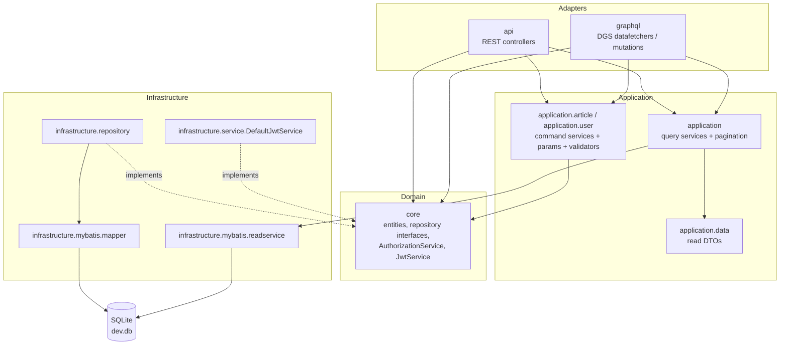
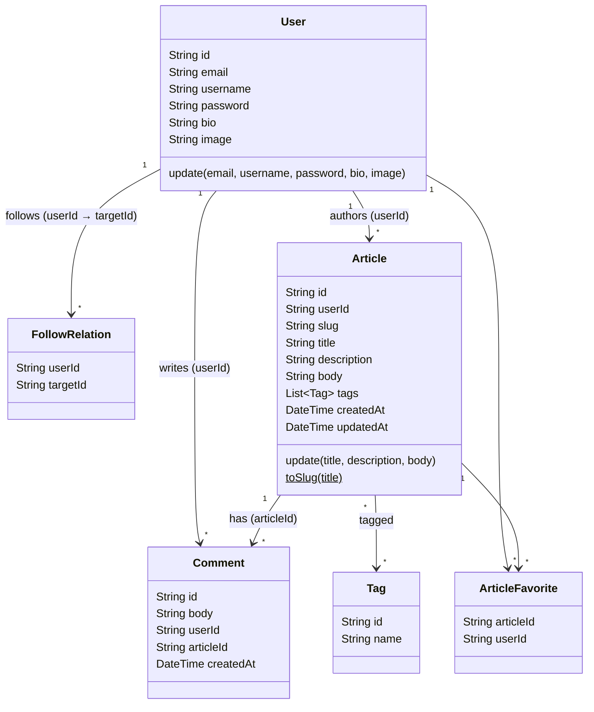
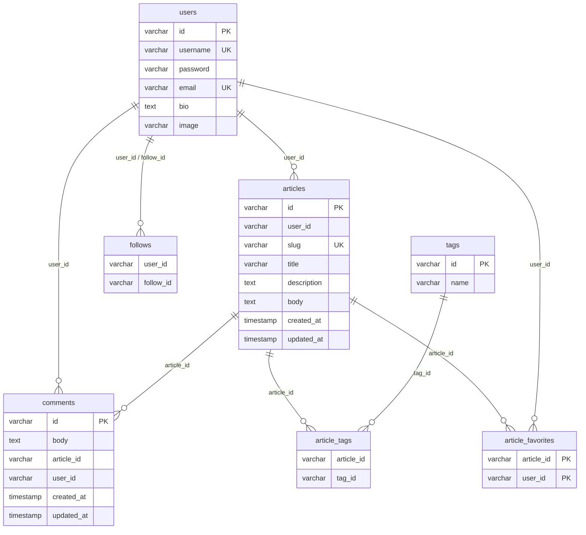
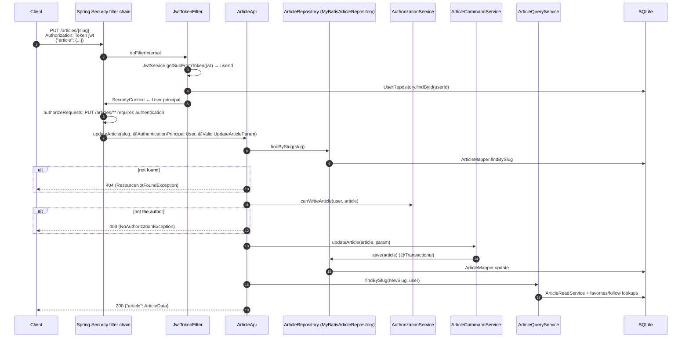

# Architecture

This document describes how the Spring Boot RealWorld backend is organized, how a request flows through it, and how security and persistence work. Everything here is derived from the source under `src/main/java/io/spring` and `src/main/resources`.

- [Design principles](#design-principles)
- [Layers and packages](#layers-and-packages)
- [Domain model](#domain-model)
- [Database schema](#database-schema)
- [Request flow](#request-flow)
- [Security](#security)
- [Persistence (MyBatis + Flyway)](#persistence-mybatis--flyway)
- [GraphQL adapter](#graphql-adapter)
- [Validation and error handling](#validation-and-error-handling)
- [Pagination](#pagination)
- [Serialization](#serialization)
- [Testing strategy](#testing-strategy)
- [Known limitations](#known-limitations)

## Design principles

- **Domain-Driven Design (lite).** Business concepts live in `core` and are independent of transport (REST/GraphQL) and storage details. REST and GraphQL are just two adapters over the same application layer.
- **CQRS.** Writes go through domain entities and repository interfaces (`core.*Repository`). Reads bypass the entities and load denormalized DTOs (`application.data.*`) directly via dedicated MyBatis *read services*.
- **Data Mapper.** MyBatis maps SQL results to objects; the domain entities have no persistence annotations.
- **Stateless auth.** Every request is authenticated from its JWT; there is no HTTP session.

## Layers and packages

| Package | Role | Key types |
| --- | --- | --- |
| `io.spring` | Bootstrapping and cross-cutting config | `RealWorldApplication` (`@SpringBootApplication`), `JacksonCustomizations` (Joda `DateTime` serializer), `MyBatisConfig` (`@EnableTransactionManagement`), `Util` |
| `io.spring.api` | REST adapter (Spring MVC `@RestController`s) | `UsersApi`, `CurrentUserApi`, `ProfileApi`, `ArticlesApi`, `ArticleApi`, `ArticleFavoriteApi`, `CommentsApi`, `TagsApi` |
| `io.spring.api.security` | HTTP security | `WebSecurityConfig` (rules, CORS, `BCryptPasswordEncoder`), `JwtTokenFilter` |
| `io.spring.api.exception` | REST error model | `CustomizeExceptionHandler` (`@RestControllerAdvice`), `ErrorResource` + `ErrorResourceSerializer`, `ResourceNotFoundException` (404), `NoAuthorizationException` (403), `InvalidAuthenticationException`, `InvalidRequestException` |
| `io.spring.graphql` | GraphQL adapter (Netflix DGS) | `ArticleDatafetcher`, `ArticleMutation`, `CommentDatafetcher`, `CommentMutation`, `MeDatafetcher`, `ProfileDatafetcher`, `RelationMutation`, `TagDatafetcher`, `UserMutation`, `SecurityUtil` |
| `io.spring.graphql.exception` | GraphQL error model | `GraphQLCustomizeExceptionHandler`, `AuthenticationException` |
| `io.spring.application` | Read side (query services) and pagination | `ArticleQueryService`, `CommentQueryService`, `ProfileQueryService`, `TagsQueryService`, `UserQueryService`, `Page`, `CursorPageParameter`, `CursorPager`, `DateTimeCursor` |
| `io.spring.application.article` / `.user` | Write side (command services), input params, custom validators | `ArticleCommandService`, `NewArticleParam`, `UpdateArticleParam`, `DuplicatedArticleConstraint`; `UserService`, `RegisterParam`, `UpdateUserParam`, `UpdateUserCommand`, `DuplicatedEmailConstraint`, `DuplicatedUsernameConstraint`, `UpdateUserConstraint` |
| `io.spring.application.data` | Read-model DTOs returned to clients | `ArticleData`, `ArticleDataList`, `CommentData`, `ProfileData`, `UserData`, `UserWithToken`, `ArticleFavoriteCount` |
| `io.spring.core.*` | Domain entities, repository interfaces, domain services | `User`, `FollowRelation`, `Article`, `Tag`, `Comment`, `ArticleFavorite`; `UserRepository`, `ArticleRepository`, `CommentRepository`, `ArticleFavoriteRepository`; `AuthorizationService`, `JwtService` |
| `io.spring.infrastructure.repository` | Repository implementations | `MyBatisUserRepository`, `MyBatisArticleRepository`, `MyBatisCommentRepository`, `MyBatisArticleFavoriteRepository` |
| `io.spring.infrastructure.mybatis.mapper` | Write-side MyBatis mapper interfaces | `UserMapper`, `ArticleMapper`, `CommentMapper`, `ArticleFavoriteMapper` |
| `io.spring.infrastructure.mybatis.readservice` | Read-side MyBatis query interfaces | `ArticleReadService`, `CommentReadService`, `UserReadService`, `TagReadService`, `ArticleFavoritesReadService`, `UserRelationshipQueryService` |
| `io.spring.infrastructure.mybatis` | Type handlers | `DateTimeHandler` (Joda `DateTime` ↔ SQL timestamp) |
| `io.spring.infrastructure.service` | Technical services | `DefaultJwtService` (JJWT implementation of `JwtService`) |

Dependency direction:

Note that the adapters also talk to `core` directly for simple writes and authorization checks (e.g. `ProfileApi` calls `UserRepository.saveRelation`, `ArticleApi` calls `AuthorizationService.canWriteArticle` and `ArticleRepository.remove`).

## Domain model

Domain rules worth knowing:

- **Identifiers** are random UUID strings generated in the entity constructors.
- **Slugs** — `Article.toSlug(title)` lower-cases the title and replaces runs of whitespace and certain punctuation (`& ? , .`, some full-width characters, curly quotes) with `-`. For example `"How to train your dragon"` → `how-to-train-your-dragon` and `"Did you train your dragon?"` → `did-you-train-your-dragon-`. Changing an article's title changes its slug. Slugs are unique (DB constraint + `DuplicatedArticleConstraint` on create).
- **Partial updates** — `User.update(...)` and `Article.update(...)` ignore null/empty values, so clients only send the fields they want to change.
- **Tags** — duplicate tag names in one request are de-duplicated; existing tags are reused by name when an article is saved.
- **Authorization** (`core.service.AuthorizationService`):
  - `canWriteArticle(user, article)` — only the article's author may update/delete it.
  - `canWriteComment(user, article, comment)` — the comment's author **or** the article's author may delete a comment.

## Database schema

Defined in `src/main/resources/db/migration/V1__create_tables.sql` and applied by Flyway at startup.

Relationships are logical only — the migration declares no foreign-key constraints.

## Request flow

### Authenticated write (REST): `PUT /articles/{slug}`

### Read (REST): `GET /articles?tag=...`

1. `JwtTokenFilter` populates the principal if a valid token is present; the route is `permitAll`, so anonymous access is fine.
2. `ArticlesApi.getArticles` builds a `Page(offset, limit)` and calls `ArticleQueryService.findRecentArticles`.
3. `ArticleReadService.queryArticles` returns matching article ids (ordered by `created_at desc`); `countArticle` returns the total.
4. `ArticleReadService.findArticles(ids)` loads `ArticleData` rows joined with author profile and tags.
5. `fillExtraInfo` sets `favoritesCount` for each article and, if the caller is authenticated, `favorited` and `author.following`.
6. The controller returns `ArticleDataList` → `{"articles": [...], "articlesCount": n}`.

## Security

Configured in `api/security/WebSecurityConfig.java` (a `WebSecurityConfigurerAdapter`).

| Aspect | Behavior |
| --- | --- |
| Session | `SessionCreationPolicy.STATELESS` |
| CSRF | Disabled (token-based API) |
| Unauthenticated access to protected routes | `HttpStatusEntryPoint(401)` — empty `401` response |
| Password hashing | `BCryptPasswordEncoder` |
| JWT filter | `JwtTokenFilter` registered before `UsernamePasswordAuthenticationFilter` |

Authorization rules (evaluated in order):

| Matcher | Rule |
| --- | --- |
| `OPTIONS` any path | permit all (CORS preflight) |
| `/graphiql`, `/graphql` | permit all (auth enforced inside resolvers) |
| `GET /articles/feed` | authenticated |
| `POST /users`, `POST /users/login` | permit all |
| `GET /articles/**`, `GET /profiles/**`, `GET /tags` | permit all |
| anything else | authenticated |

**JWT handling**

- `DefaultJwtService` builds an HMAC key from `jwt.secret` bytes (`SecretKeySpec`, algorithm name HS512) and signs with `Jwts.builder().signWith(key)`. JJWT picks the algorithm from the key length and rejects keys under 256 bits with a `WeakKeyException`; the default 86-byte secret results in `HS512` tokens.
- Token claims: `sub` = user id, `exp` = now + `jwt.sessionTime` seconds. No issuer/audience claims.
- `JwtTokenFilter` reads the `Authorization` header, takes the second whitespace-separated token (so the scheme word — `Token` per the RealWorld spec, or `Bearer` — is not checked), validates it with `getSubFromToken`, loads the `User` by id, and sets a `UsernamePasswordAuthenticationToken` with the `User` entity as principal and no authorities. Invalid/expired tokens are silently ignored, leaving the request anonymous.
- Controllers receive the user via `@AuthenticationPrincipal User`; GraphQL resolvers use `SecurityUtil.getCurrentUser()`.
- `GET /user` and `PUT /user` echo back the token that was sent rather than issuing a new one.

**CORS** — `corsConfigurationSource()` registers for `/**`: origins `*`, methods `HEAD, GET, POST, PUT, DELETE, PATCH`, headers `Authorization, Cache-Control, Content-Type`, `allowCredentials=false`.

## Persistence (MyBatis + Flyway)

- **Datasource**: SQLite via `org.xerial:sqlite-jdbc`; URL `jdbc:sqlite:dev.db` (relative to the working directory). The `test` profile uses `jdbc:sqlite::memory:`.
- **Migrations**: Flyway runs `db/migration/V*.sql` on startup.
- **Mappers**: interfaces annotated `@Mapper` in `infrastructure.mybatis.mapper` / `.readservice`, with SQL in `src/main/resources/mapper/*.xml`. `TransferData.xml` holds shared result maps (namespace `transfer.data`) that assemble `ArticleData`, `CommentData`, `ProfileData` from joined rows.
- **Write side**: `MyBatis*Repository` classes implement the `core` repository interfaces. `MyBatisArticleRepository.save` is `@Transactional` and, for new articles, inserts missing tags, the article–tag relations and the article row.
- **Read side**: read services return DTOs or id lists directly; query services compose them (e.g. fetch ids → fetch rows → batch-fill favorite counts / following flags) to avoid N+1 lookups.
- **Type handling**: `DateTimeHandler` converts Joda `DateTime` ↔ JDBC timestamps; `map-underscore-to-camel-case=true` maps `created_at` → `createdAt`.
- **SQL dialect**: the mappers use SQLite/MySQL-style `limit offset, count`; porting to another database may require mapper changes.

## GraphQL adapter

- Framework: Netflix DGS (`graphql-dgs-spring-boot-starter` 4.9.21). Endpoint `/graphql`, GraphiQL at `/graphiql`.
- Schema: `src/main/resources/schema/schema.graphqls`. The `com.netflix.dgs.codegen` plugin (`generateJava` task) generates Java types and `DgsConstants` into package `io.spring.graphql` under `build/generated`; the data fetchers use these generated types (`Article`, `ArticlesConnection`, `CreateArticleInput`, ...).
- Resolvers reuse the same application services and repositories as the REST API.
- Mutations such as `createArticle` return an empty payload plus a `localContext`; nested fields (e.g. `ArticlePayload.article`, `Article.author`, `Article.comments`) are resolved by child data fetchers that read that context.
- Authentication: `/graphql` is `permitAll` at the HTTP layer; mutations that need a user call `SecurityUtil.getCurrentUser().orElseThrow(AuthenticationException::new)`. That `io.spring.graphql.exception.AuthenticationException` is not handled specially, so an anonymous call to e.g. `followUser` returns an error with `errorType: INTERNAL`.
- Errors: `GraphQLCustomizeExceptionHandler` maps `InvalidAuthenticationException` → `errorType: UNAUTHENTICATED`, `ConstraintViolationException` → `errorType: BAD_REQUEST` with field errors in `extensions`; everything else falls back to DGS's default handler (`errorType: INTERNAL`). `createUser` instead returns validation failures as data via the `UserResult = UserPayload | Error` union.

## Validation and error handling

- Request DTOs use Bean Validation (`@NotBlank`, `@Email`) plus custom constraints backed by repository lookups: `DuplicatedEmailConstraint`, `DuplicatedUsernameConstraint`, `DuplicatedArticleConstraint`, and the class-level `UpdateUserConstraint` (email/username must not belong to another user).
- Command services are `@Validated`, so constraints also run when the GraphQL adapter calls them.
- `CustomizeExceptionHandler` maps:
  - `MethodArgumentNotValidException` / `ConstraintViolationException` / `InvalidRequestException` → `422` with `{"errors": {"field": ["message", ...]}}`
  - `InvalidAuthenticationException` → `422` with `{"message": "invalid email or password"}`
- `ResourceNotFoundException` (`@ResponseStatus(NOT_FOUND)`) and `NoAuthorizationException` (`@ResponseStatus(FORBIDDEN)`) produce Spring Boot's default error JSON (`timestamp`, `status`, `error`, `path`).

## Pagination

- **REST** — offset based. `Page(offset, limit)` defaults to `offset=0`, `limit=20`; negative/zero values fall back to the defaults and `limit` is capped at **100**.
- **GraphQL** — cursor based (Relay connections). `CursorPageParameter` defaults to `limit=20` and caps at **1000**. Cursors are `DateTimeCursor`s built from the article's `updatedAt` or the comment's `createdAt`; GraphQL exposes them as epoch-millisecond strings (e.g. `"1790797752175"`). One extra row is fetched (`limit + 1`) to compute `hasNextPage` / `hasPreviousPage`.

## Serialization

- `spring.jackson.deserialization.UNWRAP_ROOT_VALUE=true` + `@JsonRootName` on params means request bodies must be wrapped (`{"user": {...}}`, `{"article": {...}}`, `{"comment": {...}}`). Unwrapped bodies fail with `400`.
- Responses are wrapped by the controllers themselves (`{"article": ...}`, `{"profile": ...}`, etc.).
- `JacksonCustomizations` serializes Joda `DateTime` as ISO-8601 in UTC (e.g. `2026-09-30T19:44:39.412Z`).
- `ArticleData` and `CommentData` implement `Node` for cursor pagination, so REST responses also include `id` and a `cursor` object (`{"data": "<ISO timestamp>"}`) alongside the RealWorld fields; comments also carry `updatedAt` (equal to `createdAt`). `ProfileData.id` and `CommentData.articleId` are `@JsonIgnore`d.

## Testing strategy

Tests live in `src/test/java/io/spring` and run with JUnit 5 (`./gradlew test`, 68 tests):

| Area | Style | Examples |
| --- | --- | --- |
| REST controllers | `@WebMvcTest` slices with mocked repositories/services, REST Assured `spring-mock-mvc`; `TestWithCurrentUser` provides a mocked authenticated user | `ArticleApiTest`, `UsersApiTest`, `CommentsApiTest`, `ProfileApiTest`, `ListArticleApiTest` |
| Application services | Query services against the in-memory DB | `ArticleQueryServiceTest`, `CommentQueryServiceTest`, `ProfileQueryServiceTest`, `TagsQueryServiceTest` |
| Repositories | `@MybatisTest` + `@ActiveProfiles("test")` via `DbTestBase` | `MyBatisArticleRepositoryTest`, `MyBatisUserRepositoryTest`, `MyBatisCommentRepositoryTest`, `MyBatisArticleFavoriteRepositoryTest` |
| Transactions | `@SpringBootTest` | `ArticleRepositoryTransactionTest` |
| Domain / infra units | Plain JUnit | `ArticleTest` (slug rules), `DefaultJwtServiceTest` |
| Context | `@SpringBootTest` smoke test | `RealworldApplicationTests` |

There are no automated tests for the GraphQL resolvers.

## Known limitations

Observed while verifying this documentation against the running application:

- `POST /articles` without a `tagList` field returns `500` (a `NullPointerException` in the `Article` constructor). Send `"tagList": []` when there are no tags. (The GraphQL `createArticle` mutation substitutes an empty list and is not affected.)
- Updating an article does not persist a new `updated_at` (the `ArticleMapper.update` statement does not set it), so `updatedAt` stays equal to `createdAt`.
- Deleting an article only deletes the `articles` row; its comments, favorites and tag links remain in the database.
- `DELETE /profiles/{username}/follow` returns `404` if the caller is not currently following that user.
- GraphQL connection fields throw (`errorType: INTERNAL`) if neither `first` nor `last` is supplied, and `me` errors if no `Authorization` header is sent.
